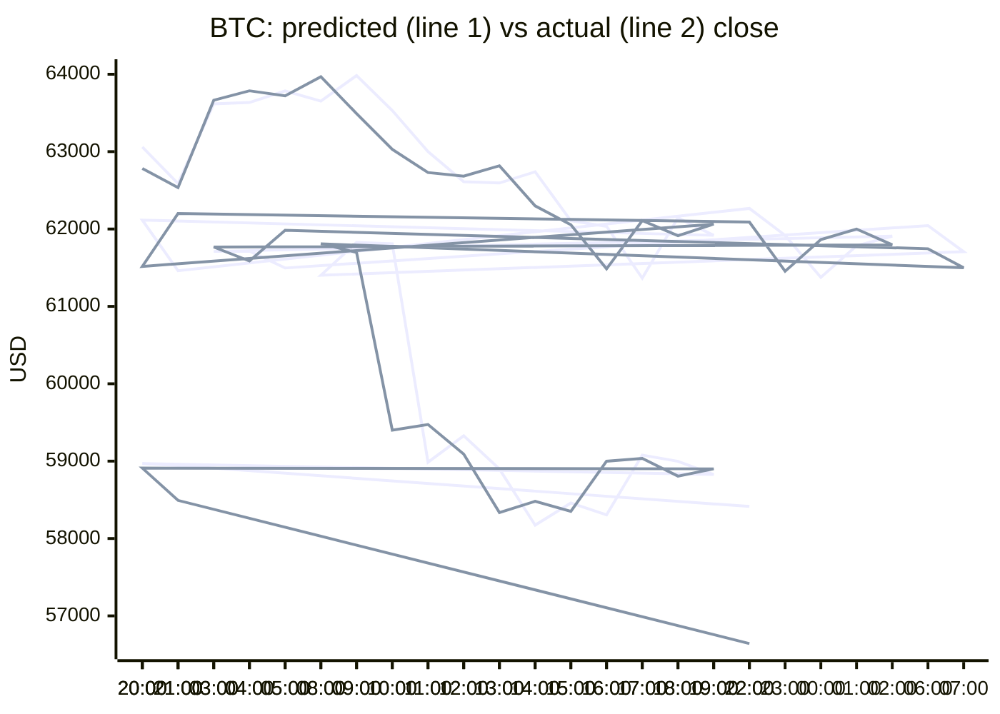
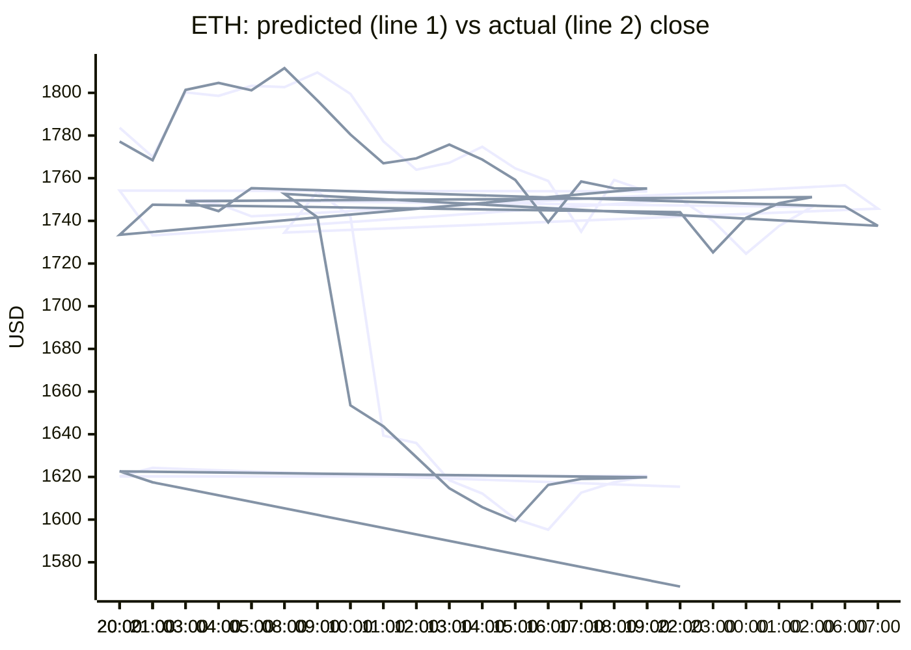
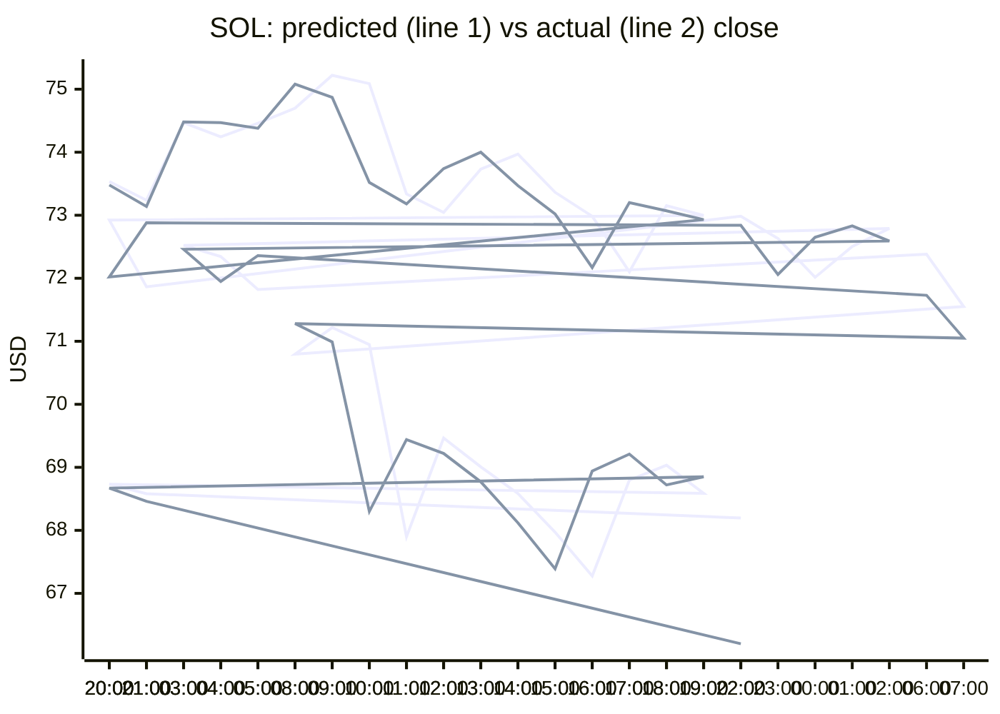
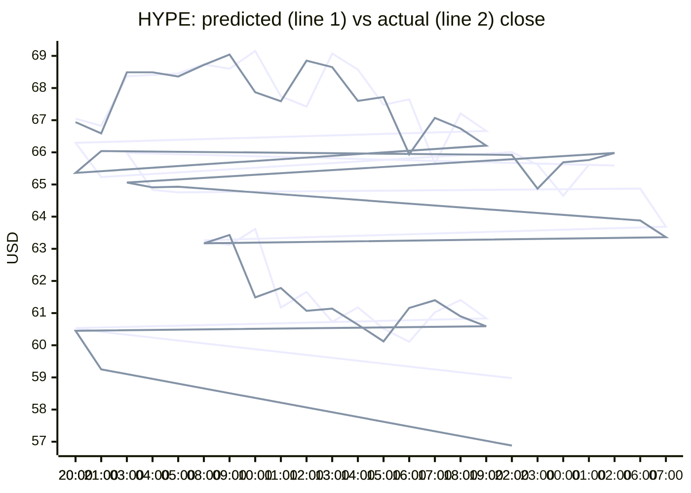

# Hourly crypto forecaster: BTC · ETH · SOL · HYPE

> This is for forecasting and measurement only. It uses Kraken's public market data and places no trades. It holds no API keys and spends nothing. All times are Eastern (America/New_York). This page is regenerated automatically on every scheduler run.

**Last updated:** 2026-11-20T23:52:36-05:00 · **Interactive dashboard:** [open it here](https://samuelkreitl-wq.github.io/crypto-hourly-forecaster/)

## Latest forecasts

| Asset | Kraken spot at run | Spot time (ET) | Forecast close at | Predicted | Range (low–high) | Direction | Confidence | Main factors |
|---|---|---|---|---|---|---|---|---|
| **BTC** | $56,732.10 | 2026-11-20 23:00:39-05:00 | 2026-11-21 00:00-05:00 | **$56,426.19** | $55,648.95 – $57,203.42 | DOWN | 55% | RSI 14 oversold -> mean-reversion lift; EMA9 below EMA21 (-1.721%); last hour -3.22%, 3h -3.91%, 24h -9.18% |
| **ETH** | $1,571.14 | 2026-11-20 23:00:39-05:00 | 2026-11-21 00:00-05:00 | **$1,561.96** | $1,535.53 – $1,588.38 | DOWN | 55% | RSI 10 oversold -> mean-reversion lift; EMA9 below EMA21 (-2.280%); last hour -3.07%, 3h -3.21%, 24h -10.60% |
| **SOL** | $66.35 | 2026-11-20 23:00:39-05:00 | 2026-11-21 00:00-05:00 | **$65.97** | $64.89 – $67.05 | DOWN | 55% | RSI 27 oversold -> mean-reversion lift; EMA9 below EMA21 (-1.691%); last hour -3.36%, 3h -3.92%, 24h -9.56% |
| **HYPE** | $57.1800 | 2026-11-20 23:00:40-05:00 | 2026-11-21 00:00-05:00 | **$56.8203** | $55.7111 – $57.9296 | DOWN | 55% | RSI 19 oversold -> mean-reversion lift; EMA9 below EMA21 (-2.775%); last hour -4.08%, 3h -6.32%, 24h -14.75% |

## Accuracy (scored forecasts only)

| Asset | Window | Scored | MAE $ | MAE % | Direction hit rate | Close inside range |
|---|---|---|---|---|---|---|
| BTC | 24h | 23 | $431.39 | 0.728% | 17.4% | 87.0% |
| BTC | 7d | 44 | $375.62 | 0.621% | 15.9% | 77.3% |
| BTC | 30d | 44 | $375.62 | 0.621% | 15.9% | 77.3% |
| ETH | 24h | 23 | $12.77 | 0.769% | 30.4% | 87.0% |
| ETH | 7d | 44 | $11.17 | 0.657% | 22.7% | 81.8% |
| ETH | 30d | 44 | $11.17 | 0.657% | 22.7% | 81.8% |
| SOL | 24h | 23 | $0.6335 | 0.916% | 26.1% | 82.6% |
| SOL | 7d | 44 | $0.5454 | 0.771% | 31.8% | 77.3% |
| SOL | 30d | 44 | $0.5454 | 0.771% | 31.8% | 77.3% |
| HYPE | 24h | 23 | $0.6382 | 1.040% | 21.7% | 78.3% |
| HYPE | 7d | 44 | $0.6115 | 0.958% | 22.7% | 77.3% |
| HYPE | 30d | 44 | $0.6115 | 0.958% | 22.7% | 77.3% |
| Combined | 24h | 92 | (mixed assets) | 0.863% | 23.9% | 83.7% |
| Combined | 7d | 176 | (mixed assets) | 0.752% | 23.3% | 78.4% |
| Combined | 30d | 176 | (mixed assets) | 0.752% | 23.3% | 78.4% |

## Predicted vs actual (last 48 scored hours)

## Recent forecasts with scores

| Asset | Hour (ET) | Start | Predicted | Range | Dir | Actual close | $ error | % error | Dir correct |
|---|---|---|---|---|---|---|---|---|---|
| BTC | 2026-11-20 23:00-05:00 | $56,732.10 | $56,426.19 | $55,648.95–$57,203.42 | DOWN | pending | — | — | pending |
| ETH | 2026-11-20 23:00-05:00 | $1,571.14 | $1,561.96 | $1,535.53–$1,588.38 | DOWN | pending | — | — | pending |
| SOL | 2026-11-20 23:00-05:00 | $66.35 | $65.97 | $64.89–$67.05 | DOWN | pending | — | — | pending |
| HYPE | 2026-11-20 23:00-05:00 | $57.1800 | $56.8203 | $55.7111–$57.9296 | DOWN | pending | — | — | pending |
| BTC | 2026-11-20 22:00-05:00 | $58,459.90 | $58,414.15 | $57,723.16–$59,105.15 | SIDEWAYS | $56,642.10 | +1772.0547 | +3.129% | no |
| ETH | 2026-11-20 22:00-05:00 | $1,616.30 | $1,615.40 | $1,591.01–$1,639.79 | SIDEWAYS | $1,568.63 | +46.7675 | +2.981% | no |
| SOL | 2026-11-20 22:00-05:00 | $68.37 | $68.20 | $67.22–$69.17 | SIDEWAYS | $66.20 | +1.9957 | +3.015% | no |
| HYPE | 2026-11-20 22:00-05:00 | $59.2100 | $58.9773 | $57.9620–$59.9926 | DOWN | $56.8800 | +2.0973 | +3.687% | yes |
| BTC | 2026-11-20 21:00-05:00 | $58,935.00 | $58,942.69 | $58,244.52–$59,640.87 | SIDEWAYS | $58,492.80 | +449.8948 | +0.769% | no |
| ETH | 2026-11-20 21:00-05:00 | $1,624.31 | $1,624.22 | $1,599.18–$1,649.27 | SIDEWAYS | $1,617.49 | +6.7336 | +0.416% | no |
| SOL | 2026-11-20 21:00-05:00 | $68.77 | $68.58 | $67.58–$69.58 | SIDEWAYS | $68.46 | +0.1212 | +0.177% | no |
| HYPE | 2026-11-20 21:00-05:00 | $60.5100 | $60.4181 | $59.4291–$61.4071 | SIDEWAYS | $59.2500 | +1.1681 | +1.972% | no |
| BTC | 2026-11-20 20:00-05:00 | $58,958.20 | $58,968.63 | $58,266.22–$59,671.05 | SIDEWAYS | $58,909.90 | +58.7345 | +0.100% | yes |
| ETH | 2026-11-20 20:00-05:00 | $1,620.83 | $1,620.21 | $1,595.16–$1,645.26 | SIDEWAYS | $1,622.59 | -2.3804 | -0.147% | yes |
| SOL | 2026-11-20 20:00-05:00 | $68.88 | $68.73 | $67.72–$69.74 | SIDEWAYS | $68.67 | +0.0618 | +0.090% | no |
| HYPE | 2026-11-20 20:00-05:00 | $60.6300 | $60.5340 | $59.5173–$61.5507 | SIDEWAYS | $60.4500 | +0.0840 | +0.139% | no |
| BTC | 2026-11-20 19:00-05:00 | $58,834.40 | $58,827.36 | $58,101.81–$59,552.90 | SIDEWAYS | $58,900.30 | -72.9448 | -0.124% | yes |
| ETH | 2026-11-20 19:00-05:00 | $1,620.72 | $1,620.45 | $1,594.82–$1,646.08 | SIDEWAYS | $1,619.82 | +0.6296 | +0.039% | yes |
| SOL | 2026-11-20 19:00-05:00 | $68.75 | $68.59 | $67.55–$69.63 | SIDEWAYS | $68.85 | -0.2636 | -0.383% | yes |
| HYPE | 2026-11-20 19:00-05:00 | $60.9000 | $60.8346 | $59.8186–$61.8506 | SIDEWAYS | $60.5900 | +0.2446 | +0.404% | no |
| BTC | 2026-11-20 18:00-05:00 | $58,978.90 | $58,997.60 | $58,280.38–$59,714.82 | SIDEWAYS | $58,806.30 | +191.2993 | +0.325% | no |
| ETH | 2026-11-20 18:00-05:00 | $1,617.99 | $1,617.47 | $1,591.85–$1,643.09 | SIDEWAYS | $1,619.32 | -1.8495 | -0.114% | yes |
| SOL | 2026-11-20 18:00-05:00 | $69.14 | $69.03 | $68.01–$70.06 | SIDEWAYS | $68.72 | +0.3129 | +0.455% | no |
| HYPE | 2026-11-20 18:00-05:00 | $61.4100 | $61.4086 | $60.3930–$62.4242 | SIDEWAYS | $60.9000 | +0.5086 | +0.835% | no |
| BTC | 2026-11-20 17:00-05:00 | $58,970.00 | $59,078.42 | $58,365.55–$59,791.28 | SIDEWAYS | $59,035.80 | +42.6154 | +0.072% | yes |
| ETH | 2026-11-20 17:00-05:00 | $1,611.71 | $1,612.62 | $1,587.03–$1,638.22 | SIDEWAYS | $1,619.08 | -6.4559 | -0.399% | no |
| SOL | 2026-11-20 17:00-05:00 | $68.78 | $68.80 | $67.79–$69.81 | SIDEWAYS | $69.21 | -0.4131 | -0.597% | no |
| HYPE | 2026-11-20 17:00-05:00 | $60.9800 | $61.0236 | $59.9917–$62.0554 | SIDEWAYS | $61.4000 | -0.3764 | -0.613% | no |
| BTC | 2026-11-20 16:00-05:00 | $58,369.00 | $58,305.64 | $57,632.52–$58,978.75 | SIDEWAYS | $58,999.00 | -693.3646 | -1.175% | no |
| ETH | 2026-11-20 16:00-05:00 | $1,599.10 | $1,595.27 | $1,570.85–$1,619.68 | SIDEWAYS | $1,616.25 | -20.9830 | -1.298% | no |
| SOL | 2026-11-20 16:00-05:00 | $67.44 | $67.27 | $66.34–$68.21 | SIDEWAYS | $68.94 | -1.6653 | -2.416% | no |
| HYPE | 2026-11-20 16:00-05:00 | $60.2700 | $60.1090 | $59.1214–$61.0966 | SIDEWAYS | $61.1600 | -1.0510 | -1.718% | no |
| BTC | 2026-11-20 15:00-05:00 | $58,502.90 | $58,458.94 | $57,800.12–$59,117.76 | SIDEWAYS | $58,351.60 | +107.3385 | +0.184% | no |
| ETH | 2026-11-20 15:00-05:00 | $1,604.32 | $1,600.28 | $1,576.89–$1,623.67 | SIDEWAYS | $1,599.36 | +0.9184 | +0.057% | no |
| SOL | 2026-11-20 15:00-05:00 | $68.09 | $67.97 | $67.09–$68.86 | SIDEWAYS | $67.39 | +0.5812 | +0.863% | no |
| HYPE | 2026-11-20 15:00-05:00 | $60.6700 | $60.5161 | $59.5888–$61.4434 | SIDEWAYS | $60.1200 | +0.3961 | +0.659% | no |
| BTC | 2026-11-20 14:00-05:00 | $58,322.60 | $58,172.50 | $57,547.78–$58,797.21 | DOWN | $58,480.80 | -308.3035 | -0.527% | no |
| ETH | 2026-11-20 14:00-05:00 | $1,615.47 | $1,612.21 | $1,589.70–$1,634.71 | SIDEWAYS | $1,605.82 | +6.3867 | +0.398% | no |
| SOL | 2026-11-20 14:00-05:00 | $68.79 | $68.58 | $67.72–$69.44 | DOWN | $68.12 | +0.4638 | +0.681% | yes |
| HYPE | 2026-11-20 14:00-05:00 | $61.2300 | $61.1765 | $60.2477–$62.1053 | SIDEWAYS | $60.6400 | +0.5365 | +0.885% | no |

## Scheduler

- Platform: Primary: GitHub Actions workflow `hourly-keeper` (always-on job that fires at HH:00:40 ET and hands off to a successor every ~5h40m). Backup: scheduled workflow `hourly-forecast` (best-effort cron), which also restarts the keeper if it is not running. Repo samuelkreitl-wq/crypto-hourly-forecaster
- Cron (UTC): `keeper: every hour at :00:40 | backup cron: 0 * * * * | 10 * * * * | 25 * * * * | 45 * * * *`
- One forecast per asset per ET hour (asset+forecast_hour key); late or concurrent triggers are skipped as duplicates. Push races reset to the latest database and re-run.
- Config: [.github/workflows/hourly.yml](.github/workflows/hourly.yml) · Raw run log: [data/scheduler_runs.jsonl](data/scheduler_runs.jsonl)

| Started (ET) | Trigger | Min after :00 | Status | New forecasts | Duplicates skipped | Scored | Gaps/errors |
|---|---|---|---|---|---|---|---|
| 2026-11-20 23:52:35-05:00 | schedule:0 * * * * | 52.6 | ok | — | BTC,ETH,SOL,HYPE | 0 | 24 |
| 2026-11-20 23:00:41-05:00 | keeper:44840883315 | 0.69 | ok | BTC,ETH,SOL,HYPE | — | 4 | 24 |
| 2026-11-20 22:00:41-05:00 | keeper:44840883315 | 0.69 | ok | BTC,ETH,SOL,HYPE | — | 4 | 28 |
| 2026-11-20 21:00:40-05:00 | keeper:44840883315 | 0.67 | ok | BTC,ETH,SOL,HYPE | — | 4 | 28 |
| 2026-11-20 20:00:40-05:00 | keeper:44840883315 | 0.68 | ok | BTC,ETH,SOL,HYPE | — | 4 | 28 |
| 2026-11-20 19:47:34-05:00 | schedule:10 * * * * | 47.58 | ok | — | BTC,ETH,SOL,HYPE | 0 | 28 |
| 2026-11-20 19:13:51-05:00 | schedule:45 * * * * | 13.86 | ok | — | BTC,ETH,SOL,HYPE | 0 | 28 |
| 2026-11-20 19:04:03-05:00 | schedule:25 * * * * | 4.06 | ok | — | BTC,ETH,SOL,HYPE | 0 | 28 |
| 2026-11-20 19:00:54-05:00 | keeper-start:44840883315 | 0.91 | ok | — | BTC,ETH,SOL,HYPE | 0 | 28 |
| 2026-11-20 19:00:41-05:00 | keeper:44798125011 | 0.68 | ok | BTC,ETH,SOL,HYPE | — | 4 | 28 |
| 2026-11-20 18:30:13-05:00 | schedule:0 * * * * | 30.22 | ok | — | BTC,ETH,SOL,HYPE | 0 | 28 |
| 2026-11-20 18:00:40-05:00 | keeper:44798125011 | 0.67 | ok | BTC,ETH,SOL,HYPE | — | 4 | 28 |
| 2026-11-20 17:00:40-05:00 | keeper:44798125011 | 0.68 | ok | BTC,ETH,SOL,HYPE | — | 4 | 28 |
| 2026-11-20 16:00:40-05:00 | keeper:44798125011 | 0.68 | ok | BTC,ETH,SOL,HYPE | — | 4 | 28 |
| 2026-11-20 15:00:40-05:00 | keeper:44798125011 | 0.67 | ok | BTC,ETH,SOL,HYPE | — | 4 | 28 |
| 2026-11-20 14:00:50-05:00 | keeper-start:44798125011 | 0.85 | ok | — | BTC,ETH,SOL,HYPE | 0 | 28 |
| 2026-11-20 14:00:40-05:00 | keeper:44749387900 | 0.68 | ok | BTC,ETH,SOL,HYPE | — | 4 | 28 |
| 2026-11-20 13:35:55-05:00 | schedule:10 * * * * | 35.92 | ok | — | BTC,ETH,SOL,HYPE | 0 | 28 |
| 2026-11-20 13:00:41-05:00 | keeper:44749387900 | 0.69 | ok | — | BTC,ETH,SOL,HYPE | 4 | 28 |
| 2026-11-20 13:00:26-05:00 | schedule:45 * * * * | 0.44 | ok | BTC,ETH,SOL,HYPE | — | 0 | 28 |
| 2026-11-20 12:54:54-05:00 | schedule:25 * * * * | 54.9 | ok | — | BTC,ETH,SOL,HYPE | 0 | 28 |
| 2026-11-20 12:25:55-05:00 | schedule:0 * * * * | 25.92 | ok | — | BTC,ETH,SOL,HYPE | 0 | 28 |
| 2026-11-20 12:00:40-05:00 | keeper:44749387900 | 0.68 | ok | BTC,ETH,SOL,HYPE | — | 4 | 28 |
| 2026-11-20 11:00:41-05:00 | keeper:44749387900 | 0.68 | ok | BTC,ETH,SOL,HYPE | — | 4 | 28 |
| 2026-11-20 10:00:41-05:00 | keeper:44749387900 | 0.68 | ok | BTC,ETH,SOL,HYPE | — | 4 | 28 |

## Data gaps, missed runs and errors

| Asset | Hour (ET) | Kind | Detail | Logged (ET) |
|---|---|---|---|---|
| HYPE | 2026-11-19T07:00-05:00 | missed_run | no forecast recorded for this hour (scheduler did not run in time) | 2026-11-19T08:18:49-05:00 |
| HYPE | 2026-11-19T06:00-05:00 | missed_run | no forecast recorded for this hour (scheduler did not run in time) | 2026-11-19T08:18:49-05:00 |
| SOL | 2026-11-19T07:00-05:00 | missed_run | no forecast recorded for this hour (scheduler did not run in time) | 2026-11-19T08:18:48-05:00 |
| SOL | 2026-11-19T06:00-05:00 | missed_run | no forecast recorded for this hour (scheduler did not run in time) | 2026-11-19T08:18:48-05:00 |
| ETH | 2026-11-19T07:00-05:00 | missed_run | no forecast recorded for this hour (scheduler did not run in time) | 2026-11-19T08:18:48-05:00 |
| ETH | 2026-11-19T06:00-05:00 | missed_run | no forecast recorded for this hour (scheduler did not run in time) | 2026-11-19T08:18:48-05:00 |
| BTC | 2026-11-19T07:00-05:00 | missed_run | no forecast recorded for this hour (scheduler did not run in time) | 2026-11-19T08:18:48-05:00 |
| BTC | 2026-11-19T06:00-05:00 | missed_run | no forecast recorded for this hour (scheduler did not run in time) | 2026-11-19T08:18:48-05:00 |
| HYPE | 2026-11-19T02:00-05:00 | missed_run | no forecast recorded for this hour (scheduler did not run in time) | 2026-11-19T03:54:56-05:00 |
| HYPE | 2026-11-19T01:00-05:00 | missed_run | no forecast recorded for this hour (scheduler did not run in time) | 2026-11-19T03:54:56-05:00 |
| HYPE | 2026-11-19T00:00-05:00 | missed_run | no forecast recorded for this hour (scheduler did not run in time) | 2026-11-19T03:54:56-05:00 |
| HYPE | 2026-11-18T23:00-05:00 | missed_run | no forecast recorded for this hour (scheduler did not run in time) | 2026-11-19T03:54:56-05:00 |
| HYPE | 2026-11-18T22:00-05:00 | missed_run | no forecast recorded for this hour (scheduler did not run in time) | 2026-11-19T03:54:56-05:00 |
| SOL | 2026-11-19T02:00-05:00 | missed_run | no forecast recorded for this hour (scheduler did not run in time) | 2026-11-19T03:54:56-05:00 |
| SOL | 2026-11-19T01:00-05:00 | missed_run | no forecast recorded for this hour (scheduler did not run in time) | 2026-11-19T03:54:56-05:00 |
| SOL | 2026-11-19T00:00-05:00 | missed_run | no forecast recorded for this hour (scheduler did not run in time) | 2026-11-19T03:54:56-05:00 |
| SOL | 2026-11-18T23:00-05:00 | missed_run | no forecast recorded for this hour (scheduler did not run in time) | 2026-11-19T03:54:56-05:00 |
| SOL | 2026-11-18T22:00-05:00 | missed_run | no forecast recorded for this hour (scheduler did not run in time) | 2026-11-19T03:54:56-05:00 |
| ETH | 2026-11-19T02:00-05:00 | missed_run | no forecast recorded for this hour (scheduler did not run in time) | 2026-11-19T03:54:55-05:00 |
| ETH | 2026-11-19T01:00-05:00 | missed_run | no forecast recorded for this hour (scheduler did not run in time) | 2026-11-19T03:54:55-05:00 |
| ETH | 2026-11-19T00:00-05:00 | missed_run | no forecast recorded for this hour (scheduler did not run in time) | 2026-11-19T03:54:55-05:00 |
| ETH | 2026-11-18T23:00-05:00 | missed_run | no forecast recorded for this hour (scheduler did not run in time) | 2026-11-19T03:54:55-05:00 |
| ETH | 2026-11-18T22:00-05:00 | missed_run | no forecast recorded for this hour (scheduler did not run in time) | 2026-11-19T03:54:55-05:00 |
| BTC | 2026-11-19T02:00-05:00 | missed_run | no forecast recorded for this hour (scheduler did not run in time) | 2026-11-19T03:54:55-05:00 |
| BTC | 2026-11-19T01:00-05:00 | missed_run | no forecast recorded for this hour (scheduler did not run in time) | 2026-11-19T03:54:55-05:00 |
| BTC | 2026-11-19T00:00-05:00 | missed_run | no forecast recorded for this hour (scheduler did not run in time) | 2026-11-19T03:54:55-05:00 |
| BTC | 2026-11-18T23:00-05:00 | missed_run | no forecast recorded for this hour (scheduler did not run in time) | 2026-11-19T03:54:55-05:00 |
| BTC | 2026-11-18T22:00-05:00 | missed_run | no forecast recorded for this hour (scheduler did not run in time) | 2026-11-19T03:54:55-05:00 |

## How it works

Every run checks each asset (Kraken pairs XBTUSD, ETHUSD, SOLUSD and HYPEUSD) in four steps:
1. It scores any earlier forecast whose hour has ended, using that hour's completed Kraken candle close. Missed scoring is caught up on the next run.
2. It logs any hour from the past 48 that has no forecast as `missed_run`.
3. If no forecast exists yet for the current ET hour, it fetches Kraken spot, the latest trade time and hourly OHLC. It computes EMA9/21, RSI14, ATR14, realized volatility, momentum and a volume ratio, then saves the forecast for the close at the next :00.
4. If an asset's feed is unavailable or stale, it logs a gap for that asset only and still forecasts the others.

Records are append-only JSONL in `data/`, keyed by asset. Every run is a git commit, and the workflow fails if any existing line changes. The model is a transparent heuristic (`heuristic-v1`), not financial advice.
